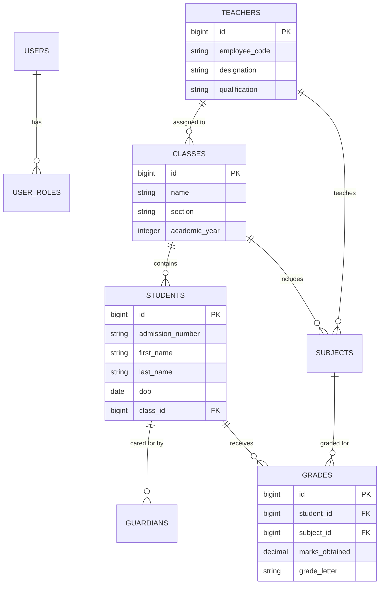

# Institutional Student & Academic Management System (School ERP)

[](https://laravel.com)
[](https://www.php.net)
[](https://pestphp.com)
[]()
[](https://www.mysql.com)
[]()

An enterprise **Academic Management and School ERP** application built with **Laravel 11** and **PHP 8.2+**. Engineered to automate institutional administrative workflows: multi-role governance (Admins, Teachers, Students, Guardians), bulk student onboarding via Excel/CSV spreadsheets (`phpoffice/phpspreadsheet`), dynamic class & subject allocation matrices, academic grading scales, and institutional announcement broadcasts.

---

## 🏛️ System Architecture & Entity Relationships



---

## 🌟 Core System Modules

### 1. 🎓 Student Life-Cycle & Guardian Directory
- **Student Profile Indexing:** Centralized tracking of student demographics, admission numbers, enrollment dates, medical records, and academic standings.
- **Guardian & Parent Linkage:** Links multiple guardians to a student profile with designated primary emergency contact flags.

### 2. 👨‍🏫 Faculty & Academic Allocation Matrix
- **Teacher Assignment:** Flexible many-to-many class and subject allocation (`TeacherController::assignClasses`).
- **Policy-Protected Operations:** Granular Laravel Authorization Policies enforcing creation, update, and deletion restrictions (`can('create', Teacher::class)`).

### 3. 📂 Bulk Onboarding & Batch Excel Importing
- **PhpSpreadsheet Integration:** Bulk upload hundreds of student records via XLSX/CSV spreadsheets (`/admin/students/upload`) with validation pre-checks and error rollbacks.

### 4. 📊 Curriculum, Subjects & Grading Scales
- **Academic Stream Governance:** Structure subjects by educational streams (Science, Commerce, Arts) and grade levels.
- **Evaluation & Grading Records:** Standardized report card generation, grade thresholds (A+, A, B, etc.), and GPA calculation.

### 5. 📢 Institutional Announcements & Broadcasts
- Campus-wide and class-specific announcement boards notifying staff, students, and guardians of schedules and examinations.

---

## 🛠️ Technology Stack

| Layer | Technologies |
|---|---|
| **Core Framework** | Laravel 11.x, PHP 8.2 / 8.3 |
| **Spreadsheet Engine** | `phpoffice/phpspreadsheet` v3.3 (High-performance batch processing) |
| **Frontend UI** | Blade Component Architecture, Tailwind CSS / Vite |
| **Database** | MySQL 8.0 (Fully relational foreign key cascades) |
| **Testing Suite** | Pest PHP v3, Pest Plugin Laravel, PHPUnit |
| **Code Formatting** | Laravel Pint |

---

## 📂 Project Organization

```
Student-Management-System/
├── app/
│   ├── Http/
│   │   ├── Controllers/
│   │   │   ├── AdminController.php             # Executive dashboard & metrics
│   │   │   ├── StudentController.php           # Student CRUD & Excel batch upload
│   │   │   ├── TeacherController.php           # Faculty allocation & subject mapping
│   │   │   ├── SubjectController.php           # Curriculum directory
│   │   │   └── SessionController.php           # Secure authentication
│   │   └── Middleware/
│   │       └── AdminMiddleware.php             # Role guard for administrative routes
│   └── Models/
│       ├── Student.php, Teacher.php, Guardian.php
│       ├── Classes.php, Grade.php, Subject.php
│       └── Announcement.php, UserRole.php
├── database/
│   ├── migrations/                             # Institutional relational schema
│   └── seeders/                                # Demo classes, teachers & students
├── routes/
│   └── web.php                                 # Scoped administrative & student routes
└── composer.json
```

---

## ⚙️ Local Development & Quick Start

### Prerequisites
- **PHP:** `>= 8.2` (Extensions: `gd`, `zip`, `xml`, `mbstring`, `pdo_mysql`)
- **Composer:** `>= 2.5`
- **Node.js & NPM:** `Node 18+` / `NPM 9+`
- **Database:** MySQL 8.0+

### Setup Instructions

```bash
# 1. Clone repository
git clone https://github.com/alramim07/Student-Management-System.git
cd Student-Management-System

# 2. Install PHP & Node dependencies
composer install
npm install

# 3. Environment configuration
cp .env.example .env
php artisan key:generate

# 4. Configure MySQL credentials in .env
# DB_CONNECTION=mysql
# DB_HOST=127.0.0.1
# DB_PORT=3306
# DB_DATABASE=sms_db
# DB_USERNAME=root
# DB_PASSWORD=

# 5. Run migrations & populate demo academic data
php artisan migrate --seed

# 6. Build assets & serve
npm run build
php artisan serve
```

Access portal at: `http://127.0.0.1:8000`

---

## 🧪 Testing & Code Quality

```bash
# Run automated Pest test suite
./vendor/bin/pest

# Run code style linter
./vendor/bin/pint --test
```

---

## 📄 License
Distributed under the [MIT License](LICENSE).
